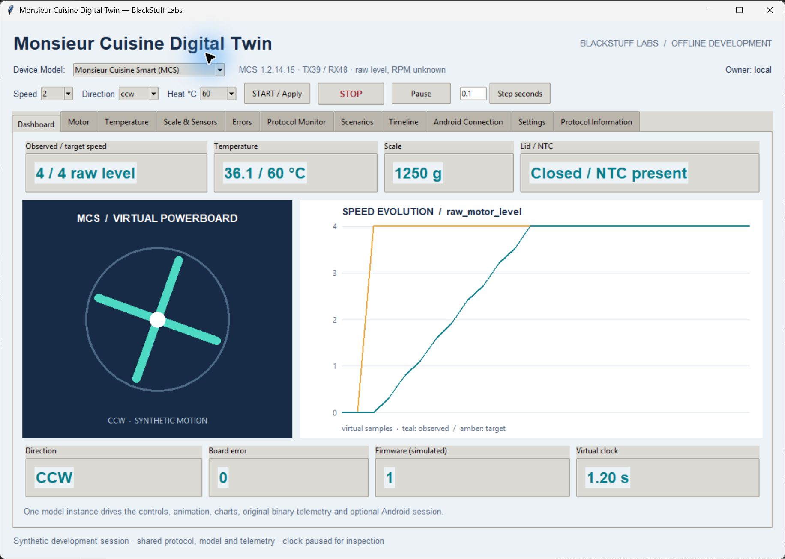
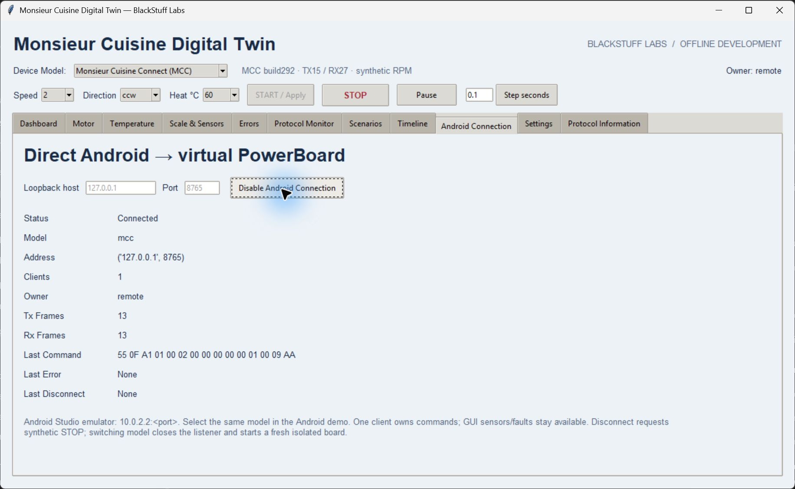
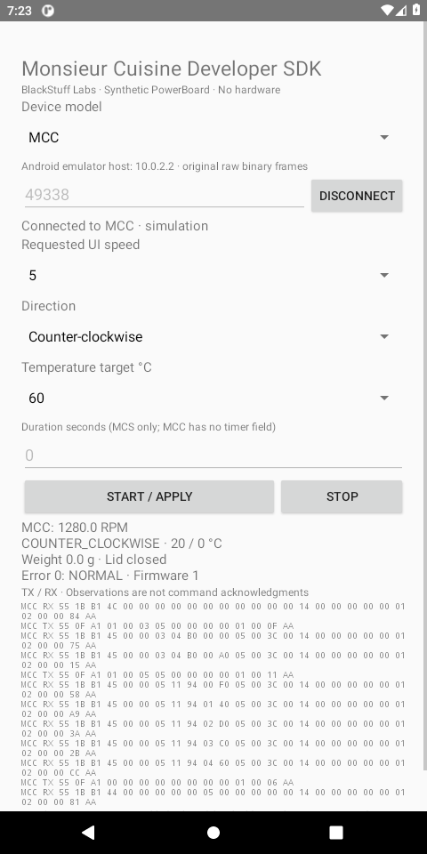

# Monsieur Cuisine Developer SDK

[](https://github.com/antrea/monsieur-cuisine-developer-sdk/actions/workflows/ci.yml)

**One SDK. Two devices. One Digital Twin.**

Develop and test software for **Monsieur Cuisine Connect (MCC)** and **Monsieur Cuisine Smart (MCS)** without owning either appliance. This independent, unofficial BlackStuff Labs toolkit combines a Python library, a Kotlin/Android SDK and one native desktop Digital Twin.

Use it to explore the original protocol bytes, build an application, test motor-control logic, inject sensor faults and reproduce a debugging session. The virtual PowerBoards maintain state and generate dynamic binary telemetry. Their physics are synthetic; the project does not certify software for a real appliance.

## Key Features

- **Unified Python SDK:** choose MCC or MCS through the same session API, with explicit device capabilities and units.
- **Kotlin/Android SDK and demo:** separate device codecs behind one client, TCP transport, mock transport and lifecycle contract.
- **Native Digital Twin:** a lightweight Tkinter/ttk desktop with a visible device selector, blade animation and trend charts.
- **Dynamic virtual PowerBoards:** motor acceleration, braking, direction, heating, temperature, scale, lid, NTC, errors and simulated firmware version.
- **Original binary protocols:** encoding, decoding, streaming validation and a live TX/RX HEX monitor.
- **Reproducible experiments:** virtual time, deterministic scenarios, seeded stress tests, recording and replay.
- **Fault injection:** delayed, lost or corrupted responses, interrupted connections and sensor/controller faults.
- **Optional Android connection:** one explicitly enabled localhost listener in the same desktop process; no separate bridge application.
- **Offline development tools:** packet builder, inspector, log analysis, telemetry export and protocol conformance CLI.

The Python runtime uses the standard library. The desktop needs Tcl/Tk; no browser, web server, Node.js, physical hardware or manufacturer firmware is required.

## Supported Devices

| | Monsieur Cuisine Connect | Monsieur Cuisine Smart |
|---|---|---|
| Profile | **MCC** | **MCS** |
| Examined host app | MCLauncher 1.1.28-release, build 292 | mc30 1.2.14.15, versionCode 10214015 |
| Observed serial interface | `ttyMT0`, 4800 baud | `ttyMT1`, 9600 baud |
| Original wire frames | TX **15** / RX **27** bytes | Operational TX **39**, legacy TX **35** / RX **48** bytes; variable envelope |
| Virtual components | Motor, heating, scale, sensors, faults and telemetry | Motor, heating, scale, sensors, faults, manual timer and telemetry |
| Development APIs | Python and Kotlin/Android | Python and Kotlin/Android |
| Speed observation | Modeled RPM; target curves are illustrative | Raw motor levels; physical RPM conversion is unknown |
| Main limits | No verified wire duration or query operation | OTA research is partial; no firmware flashing |

The profiles retain independent field layouts, checksums, temperature tables and error meanings. Numeric speed levels are not physically equivalent across models. The SDK does not open either observed hardware serial interface.

## Screenshots

These are real captures of the independent desktop and Android demo, using synthetic data. Open an image for the full-size view.

<table>
<tr><th>MCC Digital Twin</th><th>MCS Digital Twin</th></tr>
<tr><td><a href="assets/screenshots/unified-mcc.png"></a></td><td><a href="assets/screenshots/unified-mcs.png"></a></td></tr>
<tr><th>Protocol Monitor</th><th>Android Connection</th></tr>
<tr><td><a href="assets/screenshots/protocol-monitor.png"></a></td><td><a href="assets/screenshots/android-connection.png"></a></td></tr>
</table>

<a href="assets/screenshots/android-demo.png"></a>

**Android Developer Demo — Emulator/Test Use.** It is an SDK example, not an official appliance application.

## Quick Start

Install Python **3.11 or newer** with working Tcl/Tk. From the repository root:

```sh
python -m pip install -e .
python -m monsieur_cuisine_sdk
```

On Linux/macOS, use `python3` if that is your Python command. Select MCC or MCS in the window, choose speed **2**, direction **ccw** and heat **60 °C**, then press **START / Apply**. Observe the synthetic telemetry and press **STOP**. Android Connection is disabled until you explicitly enable it.

For a headless check:

```sh
python -m monsieur_cuisine_sdk --headless
mc-sdk --model mcc capabilities
mc-sdk --model mcs conformance
```

[Installation for Windows, Linux and macOS](docs/setup.md) · [First steps tutorial](docs/first-steps.md) · [Quick Command Reference](docs/quick-commands.md)

## Python Example

The same application can select either model:

```python
from monsieur_cuisine_sdk import DeviceModel, DigitalTwin, replay

for model in (DeviceModel.MCC, DeviceModel.MCS):
    twin = DigitalTwin(model=model, seed=292)
    twin.start_motor(speed=2, direction="ccw", temperature=60)
    twin.advance(0.5)  # virtual seconds; no real-time wait
    print(model.value, twin.get_state().actual_speed, twin.get_state().speed_unit)
    twin.set_sensors(error_code=3)  # synthetic, profile-specific controller error
    twin.sample()
    twin.stop_motor()
    twin.advance(2)
    assert replay(twin.recording).get_state() == twin.get_state()
```

State, capabilities, raw frames and recordings are available without starting the GUI or a network listener. See the [Python reference](docs/api.md) and runnable [examples](examples/).

## Android Development

Open [`android/`](android/README.md) in Android Studio. It contains the complete `sdk` and `demo` modules, Gradle wrapper, independent MCC/MCS codecs, JVM tests and Activity instrumentation.

1. Prepare a standard Android Studio emulator and build the **debug** demo.
2. Start the desktop and select the same model in both applications.
3. Enable **Android Connection** in the desktop.
4. Connect the demo to emulator host **`10.0.2.2`**, port **8765 for MCC** or **8766 for MCS**. The port is configurable.
5. Send START, change speed, inspect telemetry, then STOP and disconnect.

Your own Android application can use `MonsieurCuisineClient`, `TwinTcpTransport` or `MockTransport`. Network calls belong on a worker thread. The connection carries the selected original binary protocol, with no JSON/HTTP wrapper or invented ACK. It runs in the desktop's existing process and shares its model.

[Android SDK and build instructions](android/README.md) · [Emulator integration and lifecycle](docs/android.md)

## Documentation

Start at **[docs/index.md](docs/index.md)**.

| Task | Guide |
|---|---|
| Install and complete a first experiment | [Setup](docs/setup.md), [First steps](docs/first-steps.md) |
| Operate each desktop tab | [Digital Twin user guide](docs/digital-twin.md) |
| Write Python or Android code | [Python API](docs/api.md), [Android SDK](android/README.md) |
| Understand device differences and original bytes | [Device profiles](docs/protocols.md), [MCC](docs/devices/mcc/README.md), [MCS](docs/devices/mcs/README.md) |
| Build, inspect or analyze packets | [Quick Command Reference](docs/quick-commands.md), [CLI reference](docs/cli.md) |
| Reproduce scenarios and debugging sessions | [Scenarios](docs/scenarios.md), [Recording and replay](docs/recording.md) |
| Check platforms, architecture and evidence | [Compatibility](docs/compatibility.md), [Architecture](docs/architecture.md), [Evidence](docs/evidence.md) |
| Resolve a problem or question | [Troubleshooting](docs/troubleshooting.md), [FAQ](docs/faq.md), [Glossary](docs/glossary.md) |
| Contribute or understand planned work | [Contributing](CONTRIBUTING.md), [Roadmap](docs/roadmap.md) |

Historical research is marked with its original build and verification scope. Current guides take precedence over historical command syntax.

## Testing

After installation, run the complete suite from the checkout:

```sh
python -m unittest discover -s tests -v
mc-sdk --model mcc conformance
mc-sdk --model mcs conformance
```

The full suite includes real Tk and loopback tests and needs a display. On a headless Linux machine, use `xvfb-run -a python -m unittest discover -s tests -v` after installing Xvfb/Tk. Python library and CLI use do not need a display.

Verification includes **97 Python tests**, **24 Kotlin/JVM tests**, **3,020 Python/Kotlin byte comparisons**, deterministic stress and actual Android Activity-to-Tk integration for both models. The [completed hosted run](https://github.com/antrea/monsieur-cuisine-developer-sdk/actions/runs/38873336351) passed all 12 Windows/Linux/macOS and Python 3.11–3.14 combinations, plus Android build/JVM integration. See [testing](docs/tests.md) and [release audit](RELEASE_AUDIT.md) for exact scope.

## Limitations

This is an **unofficial, independent, open-source developer toolkit**. It is not affiliated with or endorsed by Lidl or Silvercrest.

Motor curves, heating, braking, sensor evolution and simulator interlocks are configurable synthetic models. A simulated response is not proof of physical execution. MCS physical RPM is unknown; MCC's modeled RPM curve is not a calibrated measurement. Passing tests does not certify appliance safety.

No OEM APK, manufacturer firmware, proprietary recipes, physical UART driver, appliance flasher or validated installation procedure for the robot is included. An original app will not use this endpoint automatically; an application you control needs an explicit source integration. Read [safety and limitations](docs/safety.md).

## Contributing

Bug reports, focused tests and documented protocol evidence are welcome. Follow [CONTRIBUTING.md](CONTRIBUTING.md), retain evidence levels and keep proprietary material and private logs out of contributions.

## License

Original SDK code, documentation and synthetic data use the [MIT license](LICENSE), preserving the predecessor contributors' notices. The Gradle wrapper and external dependencies retain their own terms in [third-party notices](THIRD_PARTY_NOTICES.md).

## Support Development

The toolkit is free and open source. If it helps your development or research, you can [support BlackStuff Labs on Ko-fi](https://ko-fi.com/blackstufflabs). Contributions are optional and help maintain and improve the project.
