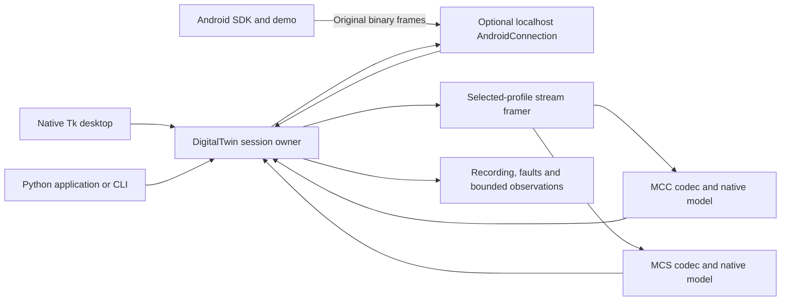

# Architecture

The SDK has one application layer and two independent device profiles. The shared layer owns a development session; each profile owns its original bytes, units and synthetic model. Selecting a model is explicit in Python, Android, the GUI, framing and recordings.

The TCP connection shares the same `DigitalTwin` shown by the desktop. It is not a second server process or simulation. Importing the package or constructing a headless twin starts no GUI, listener, device or background clock.

## Shared ownership and lifecycle

`api.py` defines `DeviceModel`, `DigitalTwin`, the frozen/detached `TwinState`, ownership and recording limits, and deterministic replay. The creating thread owns mutations. Remote command ownership is a lease granted to one accepted client; a second client cannot steal it. Host sensor/fault injection remains available. Desktop STOP disconnects remote control and disarms the old session.

`framing.py` selects one protocol, retains incomplete input and diagnoses rejected frames. Foreign-envelope quarantine prevents payload bytes in another model's frame from being reinterpreted as a nested local START. A checksum-valid frame still needs profile-specific semantic validation before the native model changes.

A rejected complete envelope is discarded as a unit. Oversized MCS envelopes retain only a small header and a remaining-byte counter until the declared frame ends; the ordinary partial-frame timeout can close an incomplete transport. An ambiguous stale tail can resemble a new header: reset/disarm at the transport boundary rather than guessing a nested command inside it. Raw API callers should use the same explicit session-reset policy.

Disconnect, overflow and model replacement remove targets and clear old fragments/queued responses as explicit host policies. Measured motion can continue coasting. Model changes advance a generation; old connection objects, callbacks and GUI jobs cannot apply results to the new generation. RX observers may read state but must defer mutations to the next owner-loop iteration. Callback exceptions are isolated and diagnosed.

## Profile boundary

| Layer | MCC | MCS |
|---|---|---|
| Canonical package | `profiles.mcc.protocol` / `.simulation` | `profiles.mcs.protocol` / `.simulation` |
| Normal wire | TX15 / RX27, A1/B1 kind | OB TX39, legacy TX35 / operation RX48 |
| Time adaptation | Nanoseconds accumulated into native milliseconds | Nanoseconds adapted to the independent bounded simulation engine |
| Speed observation | Modeled RPM, illustrative requested-RPM table | Native raw motor level; physical RPM unknown |
| Optional timer/OTA | No wire duration/query invented | Native manual timer/query and qualified offline OTA shapes |

Each adapter validates supported common requests and translates only established units. `temperature=40` is a legal MCS manual target and an explicit MCC error. MCC duration must be zero. Error numbers, signed/raw fields, interlocks and firmware hypotheses retain their profile meaning. [Protocol profiles](protocols.md) and the [machine specs](../specs/README.md) contain the actual layouts.

Legacy import aliases point at canonical module objects, preserving enum/class identity. They are compatibility seams for headless helpers; there is no copied old desktop behind the aliases. New applications use the common API. See [migration](migration.md).

## Faults, observations and replay

The shared facade records model-explicit actions, expected RX bytes and deterministic checkpoints. It routes delay/drop/corruption faults through a bounded response queue. Accepted command effects do not disappear merely because their synthetic response is dropped. History, protocol console and diagnostics are bounded separately from complete action recording.

Replay validates known operations, input/work/size limits and selected models before reconstructing the session. It executes no network endpoint or file-supplied callback. Generation, stream remainder, faults and pending responses remain part of the host model rather than fabricated wire fields. [Recordings](recording.md) documents quota and terminal-stop behavior.

## Desktop and Android

`gui.py` drives the twin from Tk's owner loop. Bounded experiments and replay verification use independent worker instances with cancellation and stale-result checks. Normal controls, chart, animation, protocol monitor and optional connection observe the same interactive twin. The [Digital Twin guide](digital-twin.md) describes the user workflow.

The Android `sdk` contains one client and duplex transport with independent codec delegates. Its worker-side API copies writes, bounds queues, allows one receiver and rejects stale session results. The debug demo invalidates queued STARTs on STOP and disconnects on backgrounding. MCS queries are throttled independently of receive throughput; the default MCS host connection avoids unsolicited periodic replies. The [Android guide](android.md) and [project README](../android/README.md) describe exact APIs and tests.

No layer is a physical UART driver, firmware emulator or safety certification. Evidence classes and third-party attribution are documented in [evidence](evidence.md) and [notices](../THIRD_PARTY_NOTICES.md).
