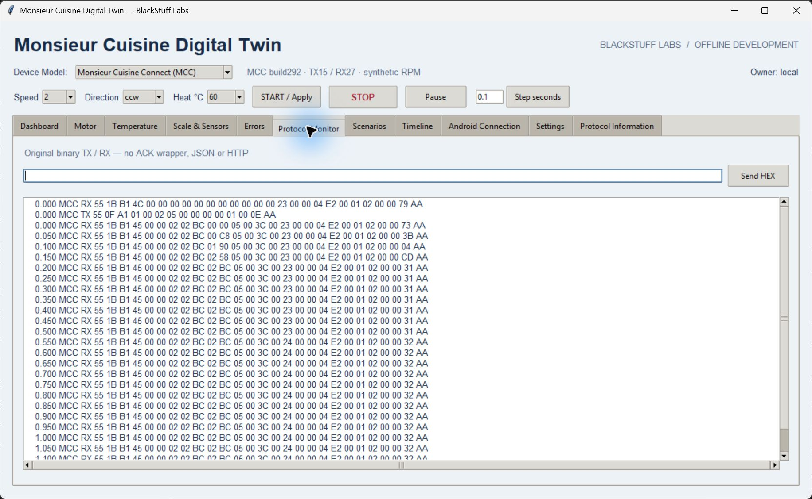

# Offline CLI

Install the package, then use `mc-sdk --model mcc ...` or `mc-sdk --model mcs ...`. The selector is mandatory and is never guessed from bytes. The module equivalent is `python -m monsieur_cuisine_sdk.cli`. Commands emit JSON; status 0 means success, 1 means a completed validation/conformance/scenario reported failure, and 2 means invalid arguments/data or I/O failure.

## Build and inspect

```sh
mc-sdk --model mcc build start --speed 2 --direction ccw --temperature 60
mc-sdk --model mcs build start --speed 2 --temperature 40 --duration 30
mc-sdk --model mcc build stop
mc-sdk --model mcs build query
mc-sdk --model mcc decode --hex "55 0F A1 00 00 00 00 00 00 00 00 00 00 05 AA"
mc-sdk --model mcc inspect --hex "55 0F A1 00 00 00 00 00 00 00 00 00 00 05 AA"
```

`build start` uses common units and validates profile capabilities. Common kinds are `start`, `stop`, `tare`, `query`. MCC has no verified query opcode and rejects it explicitly. MCC also rejects a nonzero duration or a 40 °C target.

Native builders accept `--params` as a JSON object. MCC kind `tx` uses `operation`, `speed`, `temperature_level`, `direction`, `tare`. MCS kinds `manual`, `operation`, `ota` use the native encoder keyword names. Examples below use POSIX single-quoted JSON. Windows PowerShell 5.1 strips the inner double quotes when calling native programs: escape them (`--params '{\"speed\":2}'`) or use PowerShell 7.3+; in Command Prompt write `--params "{\"speed\":2}"`.

```sh
mc-sdk --model mcc build tx --params '{"operation":"turbo","speed":10}'
mc-sdk --model mcs build manual --params '{"speed":2,"seconds":30,"reverse":true}'
mc-sdk --model mcs build ota --params '{"subcommand":2,"packet_sequence":1,"data_hex":"0102"}'
```

OTA is MCS offline frame-shape generation only. No firmware validation, connection or flashing occurs. Native and common arguments cannot be mixed silently: `--speed`, `--direction`, `--temperature`, `--duration` belong only to `build start`; native kinds use `--params`.

MCS `decode`/`inspect` need `--direction tx` for command layouts or `--direction rx` (default) for telemetry. Direction is relative to the Android host. MCC's A1/B1 kind identifies its layout internally. A checksum match alone is not semantic or physical validation.

## Streams, logs and telemetry

```sh
mc-sdk --model mcc validate --file frames.hex --input-format hex
mc-sdk --model mcs validate --file frames.bin --input-format binary --direction rx
mc-sdk --model mcc analyze frames.hex
mc-sdk --model mcs analyze fixtures/mcs/telemetry.jsonl --input-format jsonl
mc-sdk --model mcs telemetry fixtures/mcs/telemetry.jsonl --input-format jsonl --csv telemetry.csv
mc-sdk --model mcc telemetry session.json --input-format recording --csv telemetry.csv
```

Hex files accept whitespace, blank lines and `#` comments. Binary input is read in chunks. Recovered frames are retained, and corruption/noise/truncated tails keep validation unsuccessful. JSONL rows have `time` (host metadata), `direction` (`tx`/`rx`) and `hex`. Each direction has an independent incremental parser. MCS sequence gaps/repeats are observations, not proof of dropped packets or request acknowledgements.

`--input-format recording` accepts the **unified** recording schema and verifies replay before exposing its RX observations. It can contain explicit model switches; each row retains the checkpoint's selected model. Deliberately corrupted expected RX remains visible as a diagnostic. CSV uses explicit `speed_unit`: MCC RPM and MCS raw levels remain distinguishable.

The native desktop shows the same original binary frames in its Protocol Monitor:



CLI file reads are bounded to 100 MB, decoded streams to 100000 frames, and JSONL to 100000 records. These are offline tools, not an unbounded packet-capture service.

## Scenarios, recordings and conformance

```sh
mc-sdk --model mcc scenario start_stop
mc-sdk --model mcs simulate thermal
mc-sdk --model mcs stress --count 1000 --seed 292
mc-sdk --model mcc record --file session.json --seconds 1
mc-sdk --model mcc replay session.json
mc-sdk --model mcc conformance
mc-sdk --model mcs conformance
mc-sdk --model mcs conformance --corpus envelope
mc-sdk --model mcs capabilities
```

`scenario` and `simulate` are aliases for the shared named scenarios. `record` creates a short deterministic synthetic start/sample/STOP session and verifies it before saving. `replay` requires the recording's initial model to match `--model` and checks bytes plus checkpoints. [Recording format and limits](recording.md) apply.

Conformance checks frozen independent corpora: MCC's eight representative isolated-JVM TX vectors; MCS's 900 manual/operation/OTA cases; or its distinct 900 envelope-reference cases. `--vectors path.json` checks a compatible replacement corpus; `--write-vectors path.json` exports the selected frozen corpus. The MCS envelope corpus is explicitly unsupported for MCC. These checks prove software byte agreement with their stated evidence scope, not hardware behavior.
