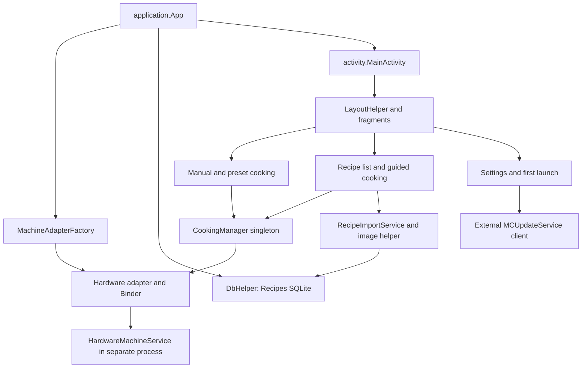

> **Historical MCC profile research.** Retained from the separate legacy toolkit. Protocol/build facts retain their stated evidence scope; API names, commands, dependency versions, screenshots and prior test counts below describe that earlier product. Use the [current unified documentation](../../../index.md) and [current evidence and validation](../../../evidence.md) for SDK 0.1.0.

# Android application architecture

The research target is package **`de.silpion.mc2`**, version **`1.1.28-release`**, versionCode **292**. The reference artifact's identity and provenance are in [research methodology](research-methodology.md). This chapter describes the examined package, not a live device configuration.

## Components and initialization

`App.onCreate()` registers activity lifecycle callbacks, creates an adapter and creates the database session. `MachineAdapterFactory.createMachineAdapter()` uses the build flavor `hardwareMachineAdapter`; a mock path exists in the source representation but is not the selected flavor of build 292. `App.onCreate()` has no visible process-name guard in the reviewed path, so initialization effects in each process require runtime evidence before stronger claims are made.

`MainActivity` is the landscape launcher/home Activity. It initializes fragments, controls, defaults, imports, first-launch handling and connectivity logic. `LayoutHelper` changes fragment/container visibility; these screens are not separate Activities for every destination. Manual, presets, recipe overview/detail, guided cooking, search, first launch, settings, tutorial and video are recognized views.

| Registered component | Role / observed declaration |
|---|---|
| `application.App` | Application initialization and lifecycle callbacks |
| `activity.MainActivity` | MAIN Activity with HOME, DEFAULT and LAUNCHER categories |
| `HardwareMachineService` | Non-exported service in `:mc.machine_service` |
| `ClientService` | Binder callback service in the app process; `stopWithTask=false` |
| `RecipeImportService` | Recipe synchronization IntentService |
| `FOTAReceiver` | Permission-protected external-update notifications and LED handling |
| Picasso provider | Non-exported image-library provider |

The presence of scanner/library components does not prove every associated UI path is active. No local `MCUpdateService` implementation is declared in the manifest.

## Cooking model and event flow

`CookingManager` is a singleton shared by manual, preset and guided paths. `SingleCookingStep` describes one configuration, limits and which parameters can change. `CookingSteps` describes a finite sequence; `RampSteps` specializes sequence/display behavior. `CookingUnit` contains a repeating list with an overall duration. Those software models are distinct from Android work-mode numbers and wire operation bytes.

Command calls traverse `ICommandInterface`, `IPCMachineAdapter`, Binder and `IPCMachineBinder`. Hardware data returns through converted state snapshots and callbacks. The [hardware architecture](hardware-architecture.md) gives both paths. An adapter's successful synchronous Binder return does not prove that the serial write succeeded or that the board applied the request.

The original manual default is clockwise. Research identified a localized default-change point in `MainFragment.initViews()`: the freshly created manual step before `initCooking()`. Changing shared preset factories or the hardware command mapping would affect recipes and other programs too. This public toolkit contains no launcher patch. A reverse default would also retain reverse speed limits and the Turbo direction gate.

## Privileged and OEM dependencies

| Observed property/dependency | Consequence of the static evidence |
|---|---|
| Requested `android.uid.system` shared UID | Ordinary app installation is not shown to satisfy the package's environment |
| minSdk 23, targetSdk 27 | Properties of this APK, not measurements of a particular robot's API level |
| `allowBackup=false`, `fullBackupContent=false` | A generic backup assumption is not justified |
| `extractNativeLibs=false` | Packaging/alignment matters independently of Java behavior |
| UART and vendor LED nodes | Device paths and effective permissions are OEM-specific |
| `DEVICE_POWER`, platform power reflection | Sleep/wake/nap depend on the system environment |
| Global configuration/locale reflection | Locale behavior depends on platform privileges |
| `EncryptionChipService` Binder | Identity/public-key access belongs to an external system service |
| MCUpdater and ADUPS/tgifota references | Update implementations belong to separately acquired components, which are absent here |

Manifest declarations show requests and registrations; they do not prove permissions granted at runtime. A custom system-version label such as `4.3a` is not enough to identify Android API 18. `SettingsFragment` reads the custom property `ro.custom.build.version` separately from the package version and powerboard-reported firmware number.

## Data, preferences and networking

The `Recipes` SQLite database uses greenDAO schema 9 and nine tables. JSON resources populate an offline catalog and image assets are copied into private app storage. Recipe favorites, language/type, validity dates and guided-step data are persisted. [Recipe format](recipe-format.md) describes that research without distributing the content.

`SharedPreferencesHelper` uses `PREFERENCES_MC2`, schema 3, for UI, language, first-launch state, import/configuration state, account state, accepted documents and bookmarks. A mismatch in the preference schema triggers reset in the examined helper. Recipe direction is stored in recipe machine values; no independent persistent manual-direction preference was identified. The public package contains no user preferences or credentials.

Two network stacks coexist: the older `McApi`/`McUsageApi` path based on `HttpsURLConnection` and AsyncTask, and `NewMcApi` using Retrofit/RxJava with OkHttp from `APIServiceFactory`. Images use Picasso. Library presence alone does not make their TLS/cache policies identical. The original code also contains identity and usage-reporting integrations; this toolkit implements no network client or authenticated API access.

The examined dependencies include Android support libraries, ButterKnife, greenDAO, Gson, Retrofit, RxJava, OkHttp/Okio, Picasso and barcode libraries. These are observations about MCLauncher, not dependencies redistributed with this project. The Python toolkit requires only the standard library at runtime.

Evidence: `AndroidManifest.xml`, `application.App`, `activity.MainActivity`, `helper.LayoutHelper`, `MachineAdapterFactory.createMachineAdapter()`, `db.model.DaoMaster`, `DbHelper.createSession()`, `SharedPreferencesHelper`, and `UpdateServiceAdapter`; ledger A01–A07/U01. See [MCUpdater and firmware](mcupdater-and-firmware.md) for the external update boundary.
