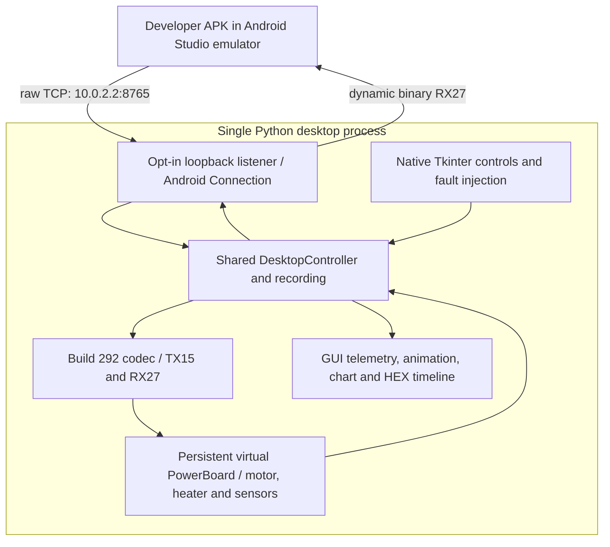

> **Historical MCC profile research.** Retained from the separate legacy toolkit. Protocol/build facts retain their stated evidence scope; API names, commands, dependency versions, screenshots and prior test counts below describe that earlier product. Use the [current unified documentation](../../../index.md) and [current evidence and validation](../../../evidence.md) for SDK 0.1.0.

# Integrated Android Connection

The native Digital Twin can accept original MCC binary commands from one development app. Enable **Android Connection** in its Tkinter window. The listener, GUI, protocol codec, recording and virtual PowerBoard share **one Python process and one model**. No second bridge program is needed.

## Start and connect

1. Run `python -m mcc_digital_twin` (`python3` where appropriate).
2. Open **Android Connection**. Leave host `127.0.0.1`, choose port `8765`, then click **Enable Android Connection**.
3. From the standard Android Studio emulator, connect your app to **`10.0.2.2:8765`**. A host-side test client uses `127.0.0.1:8765`.
4. Send original 15-byte TX commands and parse 27-byte RX status frames. Observe the same motor, sensors, graphs and HEX timeline in the desktop.
5. Send STOP, observe measured RPM reach zero, disconnect, then disable the listener when finished.

Normal startup opens **no socket**. Explicit CLI opt-in is also available: `python -m mcc_digital_twin --bridge-port 8765`. The GUI accepts literal IPv4 loopback addresses and `localhost`; wildcard, LAN, IPv6 and arbitrary DNS names are rejected. Port `0` selects an ephemeral port for tests. The Android demo accepts ports 1–65535 and fixes the emulator host to `10.0.2.2`.

The tab reports Disabled, Listening, Connected, Disconnected or Error, listener address/state, owner, client count, accepted TX count, complete RX frames written, last command and protocol/error diagnostics. Disconnected means the listener remains available. Counters describe bytes accepted/written by this development endpoint, **not execution acknowledgments**.



## Ownership and disconnect policy

Local mode gives motor commands to the GUI. A connected client takes a single exclusive command lease; takeover first requests synthetic STOP and clears old transport state. START, tare, HEX submission, new-session and session-loading calls cannot bypass the lease. Local sensor/fault injection, clock controls, recording and telemetry remain available. Additional clients are closed without replacing the owner.

Desktop **STOP** explicitly disconnects the client and requests STOP. Peer EOF, timeout, output overflow, Disable and closing the window also release ownership, discard input fragments/queued responses and request STOP. Measured RPM then decays according to the selected model; it does not teleport to zero. Heating is requested off. Reconnection starts without automatic motor restart or replay of previous START commands. A deliberate new command may start the model while old physical inertia is still represented.

This is a **synthetic host policy**, not an observed PowerBoard watchdog or hardware interlock. The older headless `PowerBoardTCPServer` API retains its prior disconnect semantics for compatibility; it is not the integrated GUI endpoint.

## Wire fidelity and bounded streaming

The transport carries unwrapped build-292 bytes: TX `55 0F A1 ... checksum AA`, RX `55 1B B1 ... checksum AA`. Each checksum sums preceding bytes modulo 256. No HTTP, WebSocket, newline envelope, ACK, transaction ID, clock or fault opcode is added. UART `/dev/ttyMT0` and the observed 4800 baud are research facts; TCP neither opens nor emulates that hardware port.

The existing parser validates and resynchronizes partial, concatenated and corrupt input. Unknown or semantically invalid commands are logged without actuation. Each poll services bounded input (up to two 4096-byte reads plus four accepts); the parser retains at most 26 incomplete bytes. Pending output defaults to 65536 bytes. Incomplete input expires after 2 seconds without further input; an inactive connection expires after 30 seconds without input/output progress. These deadlines use an injectable monotonic host clock, separate from deterministic physics time. Periodic delivered telemetry counts as activity.

Desktop preview samples status on its GUI tick, nominally about 50 ms. Accepted commands can also produce RX immediately. The cadence and configurable loss/corruption/delay faults are simulator policies; status is not a per-command ACK. If paused, virtual physics and periodic status stop; explicit commands and sensor injection can still generate RX. Start receiving before waiting for any particular state. Never infer STOP completion from a successful write.

Verified byte layout and conversions: [serial specification](serial-protocol-v292.md), [responses](response-fields.md), [commands](commands.md). Unknown RX byte 24 is retained as unknown. Motor/thermal coefficients, RPM targets, interlock behavior and simulated firmware number remain [model assumptions](powerboard-simulator/fidelity.md).

## Python embedding API

```python
from mcc_digital_twin.bridge import DesktopBridge
from mcc_powerboard_simulator.desktop_controller import DesktopController

controller = DesktopController()
with DesktopBridge(controller, port=8765) as connection:
    connection.poll()       # nonblocking, on the creating/controller thread
    controller.advance(20) # explicit virtual milliseconds
    connection.poll()
    print(connection.snapshot())
```

An embedding event loop repeats these calls; the snippet closes its listener immediately on exit. Construction/import alone is inert. `start()`, `poll()`, `disconnect(reason)`, `close()`, `running`, `client_connected`, `address` and `snapshot()` are public. A closed instance cannot restart. Optional constructor arguments are `host`, `port`, `max_pending_bytes`, `idle_timeout_ms`, `fragment_timeout_ms` and `clock` (monotonic seconds). The GUI owns polling and time advancement; do not add a competing simulation loop.

`DesktopController.subscribe_rx(callback)` returns an unsubscribe function. `claim_control(owner)`, `release_control(owner)` and `feed(raw, owner=owner)` express a source-level command lease. They are not wire fields. `reset_transport()` on the controller/model/recording discards fragments and delayed responses, retaining physics state. Recorded resets replay deterministically; older recording-v1 files remain readable. Host connection metadata is diagnostic rather than a network replay recipe.

See [emulator setup](android-emulator.md), [demo and verification](android-demo.md) and the [Kotlin SDK API](../../../../android/README.md).
