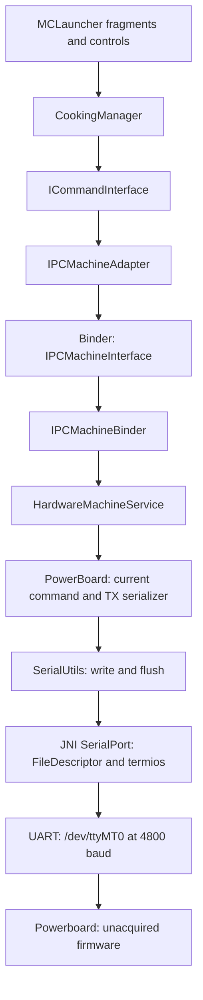

> **Historical MCC profile research.** Retained from the separate legacy toolkit. Protocol/build facts retain their stated evidence scope; API names, commands, dependency versions, screenshots and prior test counts below describe that earlier product. Use the [current unified documentation](../../../index.md) and [current evidence and validation](../../../evidence.md) for SDK 0.1.0.

# Hardware boundary and command path

The examined software separates the Android computer from the powerboard that reports motor, heating and scale state. The application shows the host side of that boundary. It does not reveal the controller firmware implementation or prove the board's electrical protection design. Statements below use the build 292 artifact identified in [research methodology](research-methodology.md).

## Host-to-board flow

`ICommandInterface.start(workMode,speed,direction,temperatureLevel)` becomes a Binder request; the server maps the parameters to `PowerBoard` setters. The hardware loop serializes the **latest state**, constructing a 15-byte frame with `PowerBoard.getSendPayload()`. It does not necessarily send one unique frame for each UI call.

The service is declared in process `:mc.machine_service`, with `exported=false`. This creates a process boundary between UI and device access, using Binder for commands and callbacks. An architectural benefit is separating the hardware loop from UI work; the manifest establishes the separation, but does not establish the original designers' reasoning or a fault-isolation guarantee. Crashing either process, losing the Binder connection or suspending the periodic loop does not demonstrate a physical STOP.

## Board-to-UI flow

`PowerBoard.areDataCorrect()` checks the response envelope and checksum. Its getters decode bitfields and numeric values. The service converts those into Android state; the shared service superclass `gm` compares snapshots and dispatches changes. `ClientService` receives callbacks in the application process. A UI callback can therefore be derived from an already cached frame; callback time alone does not establish receive time.

The original reader subdivides a read into 27-byte blocks and retains only the last complete block. It does not implement the stream reassembly and resynchronization provided by this toolkit. See [timing and state](timing-and-state.md).

## Responsibility map

| Component | Responsibility supported by the examined code | Not established by that evidence |
|---|---|---|
| Android UI and `CookingManager` | User parameters, recipes, presets, countdowns, validation and lifecycle actions | Exact physical scheduling or braking |
| Android hardware service | Work-mode mapping, current command, periodic serialization, sensor conversion | Guaranteed delivery or command-correlated acknowledgment |
| JNI serial library | Open/close descriptor, raw termios and speed selection | Motor regulation, heating control or a firmware flasher |
| Powerboard | Supplies motor/heater status, RPM, temperatures, weight, errors and firmware-number field | MCU model, control-loop algorithms, watchdog, flash layout or interlock implementation |
| OEM system services | Identity chip, platform power operations, external updater/FOTA references | Their complete behavior; implementations were not acquired |

It is reasonable to infer that low-level actuation and regulation occur beyond the Android serializer, because Android sends levels and receives actual RPM and temperature. That inference does not locate every protection or timer on a particular chip. MediaTek/MT6580 references in historical research concern the Android tablet and do not identify the powerboard MCU.

## Native and electrical limits

The APK carries `libserial_port.so` for `armeabi-v7a`, `arm64-v8a` and `x86`. The examined native paths implement JNI descriptor handling and termios setup; frame construction is in managed code. Static inspection of those wrappers did not identify an MCU firmware payload or a programming protocol.

The service explicitly chooses `/dev/ttyMT0` at 4800 baud. The device node does not identify electrical voltage or wiring. Historical voltage observations are insufficient to assert complete TTL characteristics, pinout, RS-232/RS-485 exclusion or safe electrical connection. The complete 8N1 configuration was also not proven: raw mode and baud assignment do not show every inherited stop-bit/timeout setting.

No hardware access library is a dependency of the public toolkit. Its native desktop and headless model work on bytes, local files and in-memory simulation. Explicitly started optional adapters expose loopback TCP or a newly allocated virtual PTY. No physical device port is opened. See [Digital Twin](powerboard-simulator/README.md), [Android architecture](android-architecture.md), [serial specification](serial-protocol-v292.md) and [safety limits](safety-and-limitations.md).
