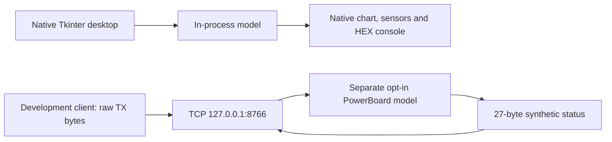

> **Historical MCC profile research.** Retained from the separate legacy toolkit. Protocol/build facts retain their stated evidence scope; API names, commands, dependency versions, screenshots and prior test counts below describe that earlier product. Use the [current unified documentation](../../../../index.md) and [current evidence and validation](../../../../evidence.md) for SDK 0.1.0.

# MCC Digital Twin / MCC PowerBoard Simulator

The Digital Twin is the interactive simulation component of **MCC Developer Toolkit**, alongside its protocol reference, decoder, packet builder, analyzer/inspector/telemetry tools and test/replay workflows. `mcc_powerboard_simulator` provides the persistent model; `mcc_digital_twin` opens its native Tkinter/ttk desktop. Motion, temperature, targets and protocol state persist between operations, with local recording/replay. Python 3.11+ is required; the GUI additionally needs the interpreter's Tk support. No EXE or installer is distributed.

The build 292 **byte format** is evidence-based. Acceleration, deceleration, heating, cooling, target-RPM points and fault behavior are explicitly chosen software hypotheses. This is not a recovered MCU firmware emulator, a certification of appliance safety or an APK patch. The model never opens a serial port or connects to a robot.

[Cross-platform quick start](crossplatform-quickstart.md) · [Native desktop](desktop.md) · [API](api.md) · [Fidelity](fidelity.md) · [Scenarios](scenarios.md)

## Start the native desktop

```console
python -m mcc_digital_twin
```

The default opens one native window and one in-process model, with no browser, HTTP/TCP listener or driver. Use `python3` where appropriate. The independent decoder/tools remain usable without Tk. The explicit `python -m mcc_digital_twin --headless` path also avoids importing Tk. See [cross-platform setup](crossplatform-quickstart.md) and [desktop controls](desktop.md).

## Optional local development service

From the extracted toolkit directory:

```console
python -m mcc_powerboard_simulator serve
```

The optional raw protocol endpoint listens at **127.0.0.1:8766**. It accepts MCC binary bytes only and has no HTTP routes or browser frontend. The address refers to your own computer. Stop it with Ctrl+C.



TCP binds literal loopback and transports ordinary MCC bytes: send TX beginning `55 0F A1`; receive RX beginning `55 1B B1`. It has no JSON wrapper, authentication or request identifier. A status reply is not a command-correlated acknowledgment. One active raw TCP client is supported. Its model is independent of an ordinarily launched desktop window; embedding programs can explicitly share a model through the Python API.

The CLI service advances the synthetic clock for an interactive preview. Direct model/server API users control virtual time explicitly; importing a module does not start a listener or a clock. Fault controls can delay, drop or corrupt synthetic responses without reproducing actual hardware failures.

## Run without listeners

```console
python -m mcc_powerboard_simulator demo --json
python -m mcc_powerboard_simulator scenario start_stop --json
python -m mcc_powerboard_simulator stress --count 1000 --seed 292 --json
python -m mcc_powerboard_simulator record --file session.json
python -m mcc_powerboard_simulator replay --file session.json
```

These commands use virtual time and in-memory state; recording/replay additionally writes/reads a local JSON file. They do not sleep for a motor simulation or open a network listener. A seed makes stress inputs reproducible; reported passes concern software assertions only. `serve --record-file interactive-session.json` saves an interactive run on clean shutdown. See [scenario descriptions](scenarios.md) for what each experiment checks.

The existing toolkit remains available independently:

```console
python -m mcc_protocol decode --file examples/samples.txt --json
python -m unittest discover -s tests -v
```

## Development integrations

With `serve` running in another terminal:

```console
python examples/powerboard_client.py
python examples/powerboard_client.py --self-test
```

The [Python client](../../../../../examples/headless.py) connects only to `127.0.0.1` and handles fragmented TCP receives. External mode checks start, acceleration, rotation and finite STOP using the running server clock. `--self-test` also injects and clears an error through the in-process Python API, using its own ephemeral TCP endpoint and explicit virtual time. Fault injection is not an invented UART opcode. Status samples are observations of synthetic state; delay/loss faults can deliberately cause a timeout.

For an application whose source you control, inject a `MockPowerBoardAdapter` through a development seam. Logic above that injected port can retain its domain operations. The [original Kotlin example](../../../../../examples/headless.py) shows constructor injection with a pure in-memory request-state mock. It uses no Android hidden API, Binder replacement or UART path. The Kotlin source is illustrative and is not a compiled/tested Android integration; adapting a real app requires changes to source that you control. The proprietary MCLauncher binary is not automatically redirected by matching bytes, and no APK patch is supplied.

An optional [serial-like memory object and fresh POSIX PTY bridge](virtual-serial.md) are implemented for development. Windows virtual COM emulation is not implemented; no drivers are installed automatically. TCP is another optional separate-process interface. There is no hardware passthrough mode.

## What to inspect

The native desktop presents requested versus measured synthetic RPM, direction, temperature, weight, lid/error state, hex frames and model events. A finite STOP reduces measured RPM over virtual time instead of instantly assigning zero. Reversal first approaches zero before accelerating in the opposite direction. These are deliberate model rules, with unmeasured parameters; they do not establish the controller's actual mechanics or protections.

Read the [fidelity matrix](fidelity.md) before interpreting a scenario result. The [build-specific protocol](../serial-protocol-v292.md) and [research limitations](../safety-and-limitations.md) remain the authority for facts about the analyzed Android artifact. Original code and documentation use the toolkit's [MIT license](../../../../../LICENSE).

For the complete command-by-command exercise, see the [detailed first-steps tutorial](../tutorials/first-steps-detailed.md).
