> **SDK 2.0 correction:** see the [build-292 OEM host-policy evidence](../../../mcc-oem-policy.md).
> Turbo starts after 100 ms, then ticks every 1 s (8 s warning, about 600 s limit);
> release/lid opening/at least 60 C stops turbo. RX reads are every 500 ms.
> Count-up stops at its speed limit; idle sleep uses 420 s plus a 30 s countdown.
> Lid/errors are app policy, not proven firmware interlocks. Calibration progression
> in the current twin is a configurable hypothesis, superseding legacy refusal.

> **Historical MCC profile research.** Retained from the separate legacy toolkit. Protocol/build facts retain their stated evidence scope; API names, commands, dependency versions, screenshots and prior test counts below describe that earlier product. Use the [current unified documentation](../../../index.md) and [current evidence and validation](../../../evidence.md) for SDK 0.1.0.

# Timing, cached telemetry and cooking state

This chapter separates observed Android scheduling from a proposed offline session model. Nominal intervals and application limits come from build 292; they are not physical response guarantees.

## Three clocks in the host software

| Path | Observed interval or clock | Meaning and limit |
|---|---|---|
| Hardware service loop, `gm.b.run()` | 100 ms sleep | Processes state and sends the current command; work and scheduling add delay |
| Serial reader, `SerialUtils.b.run()` | 500 ms sleep | Read/cache behavior; not a 500 ms board sample specification |
| Cooking countdown, `BaseCountDownTimer` | 1000 ms Handler ticks with `elapsedRealtime()` | Monotonic elapsed-time basis; no real-time deadline guarantee |
| User pause, `CookingManager.pauseCooking()` | 30,000 ms autostop when configured with listener | Different semantics from a programmed rest phase |

The serializer has no duration field. Android tracks the cooking sequence while the board reports operating state. Controller-local runtime limits or timing algorithms cannot be fully recovered from these host intervals.

## Requests, writes and observations are different events

`CookingManager.g()` calls start and `h()` calls stop. The IPC adapter returns false for a missing service or `RemoteException`; the manager's examined paths do not act on those boolean results. Even a true return means only that the Binder call returned. `SerialUtils.send()` catches a write `IOException` and logs it without propagating it as a failed cooking command.

The hardware service holds mutable current command state. Consider these illustrative host events:

```text
t0       UI requests STOP: current command becomes 00
t0 + 1   UI requests START: current command becomes 01
t0 + 2   Periodic loop serializes current command: sends 01
```

The times are **synthetic**, with arbitrary units. They explain why a successful STOP call followed by START does not guarantee a STOP frame appeared between them. Finite `CookingSteps` requests a stop and then the next start without a proven wire acknowledgment barrier.

## Original receive behavior

The reviewed Smali for `SerialUtils.b.run()` reads into a buffer, considers complete 27-byte blocks and retains the last block. It does not retain an incomplete tail between reads or search for an offset header to recover alignment. Multiple blocks can overwrite earlier events before the service sees them. `getDeviceData()` clones the cached last block, without a receive timestamp or generation number.

`PowerBoard.areDataCorrect()` can repeatedly validate that unchanged cached block. Its checksum proves neither age nor relationship to a command. An invalid block is rejected, but rejection alone was not shown to create a new host stop/fault event. No host timeout based on the age of the last valid received frame was identified in this path. The board's serial-communication error code is not evidence of such a timeout.

The public `StreamParser` is deliberately more robust for **offline input**: it assembles split frames, accepts concatenated frames, validates candidates and resynchronizes after corrupt or unrelated bytes. It reports discarded data and invalid candidates; clean decoding after recovery does not make an entire dirty input valid. End-of-input with a partial frame remains an error. This does not retrofit freshness into an original Android session or demonstrate the original hardware transport's reliability.

## Original cooking state

| State | Value | Observed high-level behavior |
|---|---:|---|
| STOP | 0 | Inactive configuration |
| RUN | 1 | Countdown/commands active |
| PAUSE | 2 | Timer suspended; stop requested for motor and heating |
| FINISHED | 3 | End of the cooking operation |

`startCooking()` validates, cancels an old timer, applies minimum speed where relevant, requests start and creates the countdown. `resumeCooking()` validates and reapplies minimum speed before restarting. `stopCooking()` cancels timers, requests stop and restores the selected step's template values. These are application states, not byte-for-byte copies of the RX motor/heater enum.

`CookingUnit` chooses a cyclic step using elapsed time modulo the sum of step durations. Its `<=` boundary can retain the previous step at an exact boundary until the next tick. User overrides of speed/temperature can survive across step changes and mask a zero-speed rest value. A simple list of alternating configurations therefore does not establish an interval with the motor physically at rest.

## Offline intermittent session design

The toolkit's intermittent model is an independent in-memory design informed by those limitations, rather than an emulation of MCU timing. Its conceptual progression is:

```mermaid
stateDiagram-v2
    [*] --> IDLE
    IDLE --> SPIN: explicit start with valid preconditions
    SPIN --> WAIT_STOP: spin deadline; request STOP
    WAIT_STOP --> REST: fresh post-STOP motor-off and zero-RPM sample
    REST --> SPIN: rest complete; revalidate before START
    SPIN --> TERMINAL: stop, deadline or fault
    WAIT_STOP --> TERMINAL: stop, deadline, timeout or fault
    REST --> TERMINAL: stop, deadline or fault
```



The model uses a fixed direction and heating disabled. It keeps a total deadline that includes spin, stopping and rest; the deadline wins over a simultaneous restart. Before starting or restarting it checks a fresh status sample, a closed lid, no active fault (including Android's scale-overload fallback), appropriate speed/direction/time limits and residual temperature. Only one initial start is permitted per program instance. The caller must serialize callbacks and ensure exclusive orchestration; there is no global coordinator preventing two instances from sharing a callback. Because it has no original thermal-consent dialog, high speed (≥4) with actual temperature ≥60 °C is rejected.

For a stopping check, the supplied local receive time must be **after** the stop request, with a newer local delivery counter, motor disabled and measured RPM zero. Reusing an earlier local sample is insufficient. An old snapshot delivered anew cannot be recognized as old from the wire bytes. The caller is responsible for routing telemetry to the intended instance. The stop timeout is checked before accepting a late zero sample, including the exact timeout boundary. The model conservatively faults if processing occurs at/after that boundary even when a synthetic delivery timestamp was earlier. A post-command sample is an observational barrier, not a newly discovered request-correlated wire ACK.

Transient lid/error/thermal events are latched; a later normal sample cannot erase a terminal event. A full rest interval begins when the stopping observation is processed. Unexpected motion during rest, unexpected heater-on telemetry, stale data, write failure, connection loss or stop timeout prevents a restart. Delayed timers do not replay missed spin phases in a burst. A terminated session does not automatically resume after reconnect or lid closure.

These are software design choices tested with synthetic events. No simulator timeout, spin duration or rest duration is a proven safe setting for an appliance. [Safety and limitations](safety-and-limitations.md) lists the remaining physical unknowns; [API documentation](api.md) gives the actual public program interfaces.

Evidence: `gm.b.run()`, `SerialUtils.b.run()`, `SerialUtils.getDeviceData()`, `SerialUtils.send()`, `CookingManager` start/pause/resume/stop and timer paths, `BaseCountDownTimer`, `CookingUnit` and `CookingSteps`; ledger P02–P05.
