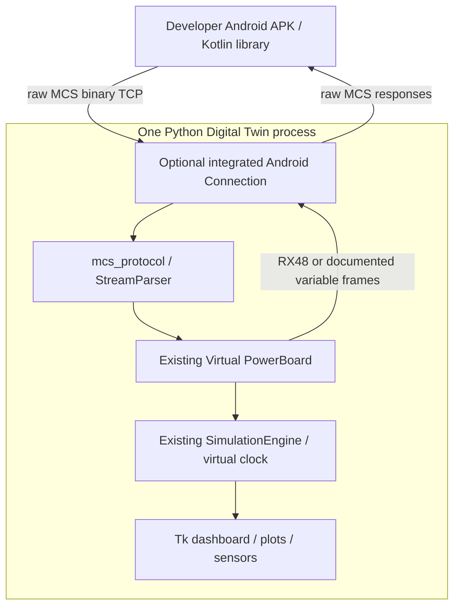

> **Historical MCS profile research.** Retained from the separate legacy toolkit. Protocol/build facts retain their stated evidence scope; API names, commands, dependency versions, screenshots and prior test counts below describe that earlier product. Use the [current unified documentation](../../../index.md) and [current evidence and validation](../../../evidence.md) for SDK 0.1.0.

# Integrated Android Connection — BlackStuff Labs

Android Connection is an **optional internal component of the MCS Digital Twin**, not a second application, proxy or server to install. One Python process owns Tk, the original SimulationEngine, Virtual PowerBoard and the nonblocking TCP listener. No web frontend or HTTP service exists. Python runtime still uses the standard library only. Normal `python -m mcs_digital_twin` opens no listener and needs no Android tools.

## Use from the desktop

1. Start `python -m mcs_digital_twin`.
2. Open the **Android** tab, headed **Android Connection**.
3. Leave host127.0.0.1 and port8766, or choose another local port. Press Enable.
4. Connect the Android emulator demo to **10.0.2.2:8766**.
5. Observe Dashboard, Motor/Temperature, Protocol HEX and Timeline while Android sends commands.
6. Use Disable to close the listener; Local Stop disconnects/disarms the remote controller first.

The section shows listener state, peer address, session owner, received/transmitted frame counts, last TX/RX and bounded communication diagnostics. It remains off until Enable or the explicit `--android-connection` flag is used. Listener accepts numeric loopback addresses only; no LAN/Internet exposure option is included. IPv4 is default. Port0 asks the OS for an available port for automated tests.

## Ownership and disconnect policy

Local Mode lets the GUI control the machine. One accepted Android connection owns all operational commands in Android Mode. A second client is immediately closed and logged. GUI motor writes, pause and fast-forward are blocked while remote control is active; GUI observation, recording and sensor/fault injection remain available. Local Stop disconnects Android and then sends stop. Reset/scenario replacement closes the listener; enabling it again is explicit.

Both acquisition and loss of remote ownership call the synthetic `DigitalTwin.disarm()` policy: remove motor/heater targets, disable timer, clear delayed replies and unsent output, preserve measured virtual state/error/tare and allow modeled coast/cooling. Reconnect starts with no active target and never replays old commands. The listener may remain Listening after a client disconnects, but the demo never reconnects automatically. This policy is **INFERRED**, not an observed MCU watchdog. Queries produce current state; RX sequences are independent and are not guaranteed ACKs.

All socket polling and model mutation happen on the owner thread, called from Tk `after`; no network thread touches widgets. GUI operations and incoming commands are therefore serialized. Headless API users likewise own one event loop. Do not mutate the twin concurrently from another thread. Importing SDK/API does not import or open sockets.

## Wire and resource rules

Raw MCS frames only: AA, u16BE lengthL, bitmap4F42, subtype, sequence, opcode/payload, positive additive checksum. Total=L+1. Operational TX39/RX48, legacyTX35 and variable OTA shapes share the same SDK parser; no JSON or proprietary TCP envelope. The active registry is multo.structs.OperationStruct. See [full protocol](en/protocol.md).

The parser handles fragments, concatenation, noise, bad lengths/checksums and explicit incomplete-prefix timeout. Defaults: frame max4096B, receive chunk4096B, output max65536B,64complete frames per poll,1024diagnostics,1s partial timeout and10s receive-idle timeout. These are host policies. Unsupported valid requests close/disarm the session with a local diagnostic; no fabricated wire error is sent. Corruption is diagnosed/resynchronized. Slow-reader overflow or flooding closes/disarms the client. Delayed synthetic replies are discarded on handoff.

0801 queries;0802 applies known operation fields;0803 supports tare mode1 only.0805 and unknown families remain unsupported/raw-decodable. OTA replies are shape-only and synthetic; there is no firmware loader or physical transport. Physical RPM, MCU image/ISA, firmware CRC/packetKey/retry and safety interlocks remain UNKNOWN.

Advanced explicit launch: `python -m mcs_digital_twin --android-connection --connection-port 8766`. Existing headless/scenario CLI remains available. `--headless --android-connection` runs the same DigitalTwin application's owner loop for automated host tests; no separate bridge program is required. Early --bridge aliases remain import/CLI compatibility names only.

See [Android SDK](android-sdk.md), [emulator](android-emulator.md), [demo](android-demo.md) and the release audit for actual executions. Free/open source. [Support BlackStuff Labs](https://ko-fi.com/blackstufflabs).
