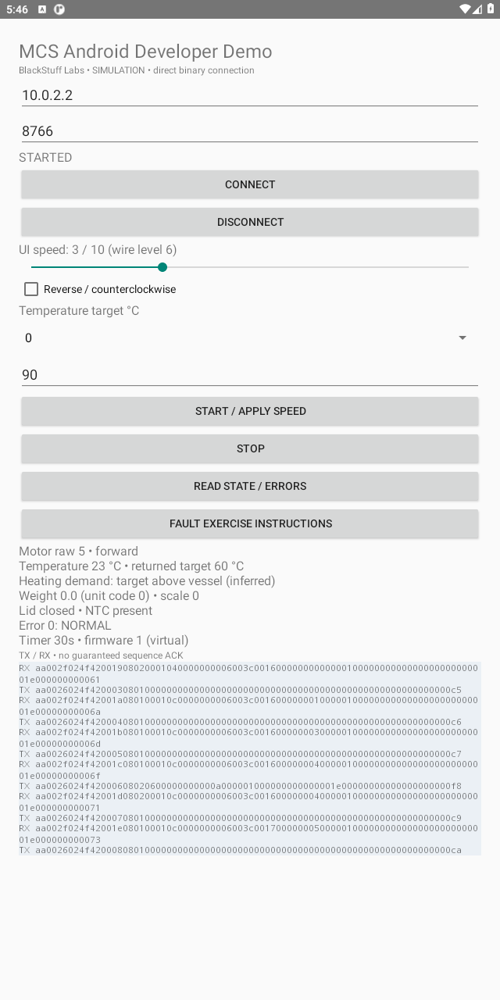
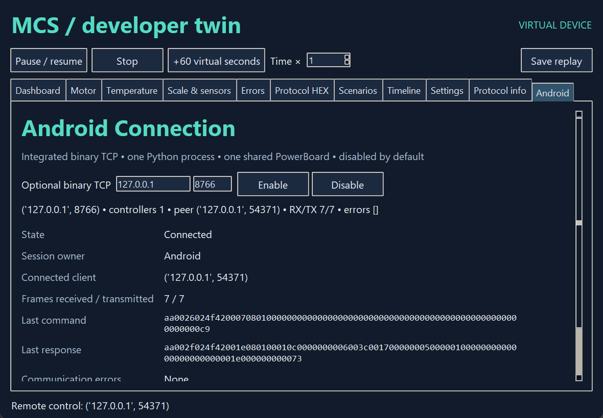

> **Historical MCS profile research.** Retained from the separate legacy toolkit. Protocol/build facts retain their stated evidence scope; API names, commands, dependency versions, screenshots and prior test counts below describe that earlier product. Use the [current unified documentation](../../../index.md) and [current evidence and validation](../../../evidence.md) for SDK 0.1.0.

# MCS Android Developer Demo

An original native Android Activity by BlackStuff Labs, using exactly the public Kotlin SDK. It connects directly to the integrated Python Android Connection. No companion bridge application, web page, server process, manufacturer layout/logo or proprietary resource is included.

Open android in Android Studio. From that directory:

```sh
./gradlew :mcs-bridge-sdk:test :mcs-bridge-demo:assembleDebug
./gradlew :mcs-bridge-demo:assembleDebugAndroidTest
```

Windows uses gradlew.bat. Android SDK locations belong in your environment/ignored local.properties. JDK17+ and pinned build dependencies are required. Build output APKs are generated artifacts excluded from the source repository. Do not install this developer APK on a physical MCS as part of this workflow.

Enable Android Connection in Python first, then run the demo on the emulator. Controls: Connect/Disconnect, speed0..10, reverse, temperature table, countdown, START/apply, STOP, state/errors and TX/RX monitor. Periodic queries update virtual motor level, temperature, inferred heating demand, weight/unit code, lid/NTC, error, timer and virtual firmware. Change speed and press START/apply again; STOP removes targets and lets the Python motor coast. Disconnect disarms; reconnection never replays START.

Fault test: in the Python Errors tab inject MOTOR_FAILURE3 while connected. Android's normal polling displays that binary error. The app's fault-instructions button explains this procedure. There is no documented MCS inject-error TX opcode, so none is invented; the host owns synthetic sensor/error injection. The automated exercise uses the same host-side policy.

## End-to-end exercise

BridgeInstrumentation launches the actual demo Activity, runs the shared client exercise off the UI thread and reports success/failure. Enable the Python test host's code3 injection after STOP (or inject manually when AWAIT_HOST_ERROR appears), then run the instrumentation on an explicitly selected emulator. Cases: connect, start, speed change, dynamic telemetry, STOP, injected error, disconnect, explicit reconnect with no restart. A companion JVM execution of the exact same exercise supports host-only verification, but is never mislabeled as an Android emulator test.

For a normal Android Studio run, fault injection remains manual through Python. Tests never add a custom network control channel or alter the MCS wire protocol. Hardware mode is a future interface only. Physical RPM and firmware behavior are unknown; all dynamics are configurable hypotheses.

Screenshots, when included, are captures of actual running software; see the audit for their provenance and the tests really executed.


## Real execution captures





Captured during the passing local instrumentation exercise; no generated mockup is used.
