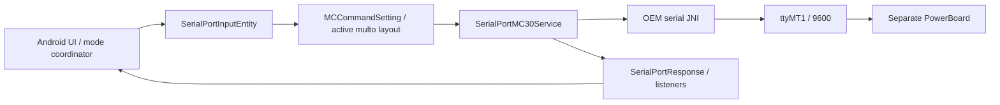
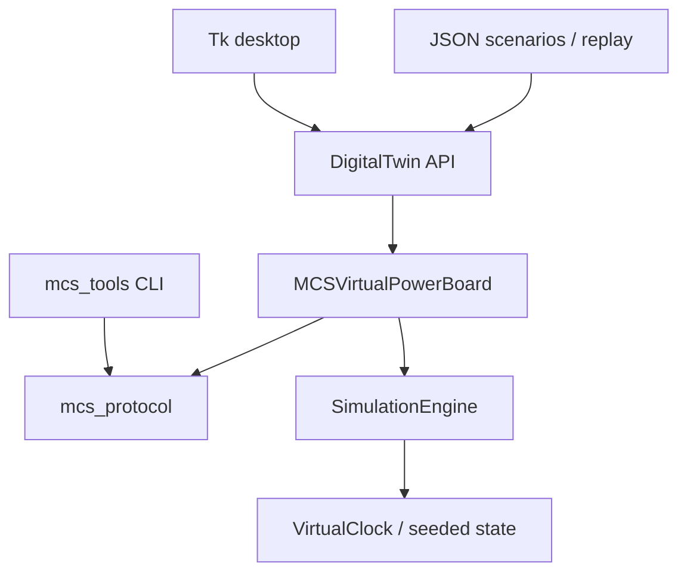

> **Historical MCS profile research.** Retained from the separate legacy toolkit. Protocol/build facts retain their stated evidence scope; API names, commands, dependency versions, screenshots and prior test counts below describe that earlier product. Use the [current unified documentation](../../../../index.md) and [current evidence and validation](../../../../evidence.md) for SDK 0.1.0.

# Android and toolkit architecture

**CONFIRMED_IN_APK:** the historical launcher uses package com.tecpal.device.mc30, android.uid.system, DeviceApplication and a landscape MainActivity/fragment UI. Min/target SDK are 26. The serial service `SerialPortMC30Service` has no separate process declaration and returns a local service binder. Do not substitute MCC's cross-process hardware service architecture. Libraries include TecPal/TGI namespaces, SQLCipher/greenDAO, Retrofit/OkHttp, RxJava, Paho MQTT, authentication and downloader components. Shared namespaces contain other product families; their presence does not establish use on MCS.

The APK loads serial native support not bundled as a standalone portable dependency in the launcher. The historical Android dump has MT8167, Android8.1/API27 and ARM32 userspace. This Android SoC is not the unknown PowerBoard MCU. Privileged permissions, OEM services and shared UID mean an unsigned rebuild does not establish a generic installable replacement. Previous offline rebuilding verified container/resource consistency only; no installation or hardware behavior was tested.

The independent toolkit intentionally needs none of those runtime components:

`mcs_protocol` is GUI-free; `model.py` contains dynamics; `board.py` applies command policy; `api.py` owns recording; `scenarios.py` schedules declarative inputs; `gui.py` is the sole runtime Tk importer. No recipe/cloud/account initialization is reproduced. MCC was consulted only for organization, clock/replay concepts and release conventions. No MCC wire coding or runtime dependency was imported.

## 0.2.0 Integrated Android Connection

The existing model/API now also supports optional direct Android TCP ownership in the same Python process. Normal startup remains local and listener-free. See [Android Connection](../android-connection.md). `DigitalTwin.disarm()` removes targets and delayed old replies during session handoff; recordings replay this new action. No physical hardware adapter is implemented.
