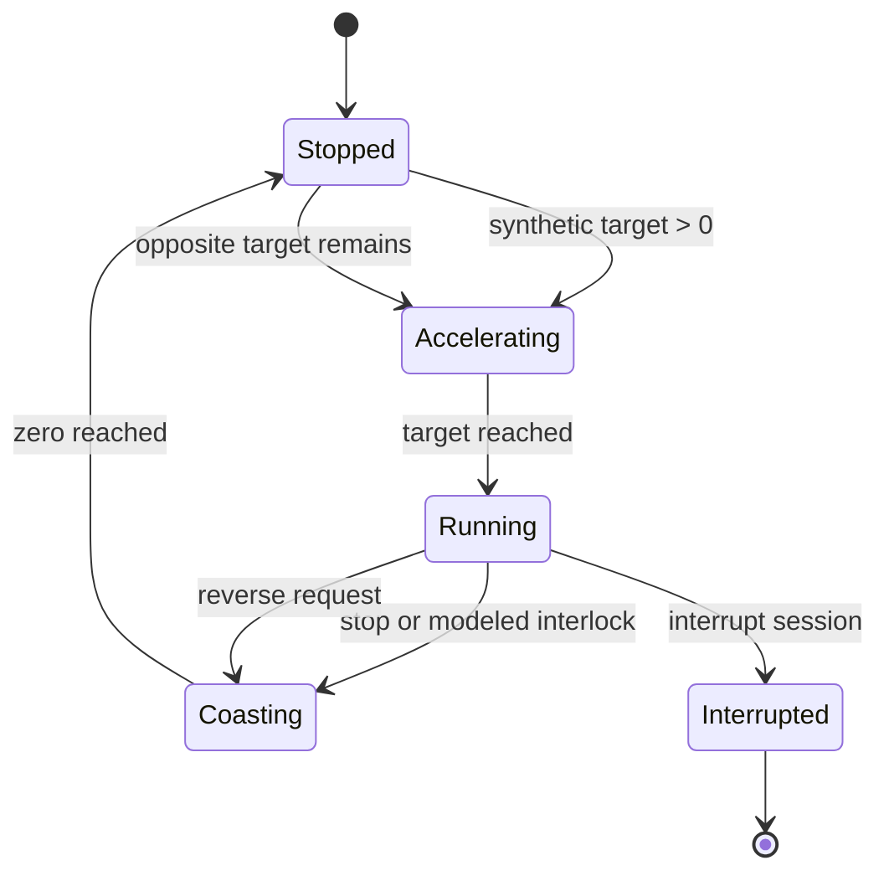

> **Historical MCS profile research.** Retained from the separate legacy toolkit. Protocol/build facts retain their stated evidence scope; API names, commands, dependency versions, screenshots and prior test counts below describe that earlier product. Use the [current unified documentation](../../../../index.md) and [current evidence and validation](../../../../evidence.md) for SDK 0.1.0.

# Digital Twin model

Every policy and coefficient here is **INFERRED**, configurable, deterministic software behavior. None is a reconstruction of MCU firmware. The protocol layer supplies verified wire shapes; the model supplies explicitly artificial state evolution.

`SimulationEngine` owns `MachineState`, a seeded random generator, `VirtualClock` and a bounded timeline. Time is integer nanoseconds. Default ticks are 0.02 s; state advances only on completed grid ticks. Inputs at fractional boundaries apply to subsequent ticks. Absent intervening inputs, partitioning an advance produces identical tick evolution. Do not mutate the state/clock directly when recording; use DigitalTwin methods so replay records inputs. Snapshots do not consume random values.

| Default parameter | Value | Synthetic interpretation |
|---|---:|---|
| acceleration / deceleration | 8 / 12 | wire levels per second |
| ambient | 22 | °C |
| heating_rate | 2 | °C/s at full modeled power |
| cooling_coefficient | 0.02 | cooling proportional to temperature difference |
| heater_lag | 0.6 | first-order power response seconds |
| stability_seconds | 0.5 | delay after mass/tare change |
| overload_grams | 5000 | absolute net weight threshold |
| noise_grams | 0 | Gaussian standard deviation, seeded |
| lid_interlock / ntc_interlock | true / true | block modeled actuation |
| overtemperature | 150 | inject error 7 |
| command_timeout | 0 | disabled; optional modeled watchdog seconds |
| timeline_limit | 10000 | most recent model snapshots |

Motor target is signed by requested direction. Reversal first decelerates to zero; the opposite acceleration begins on a later tick. Stop removes target but retains coast. The model uses absolute level plus direction in RX. It never reports invented physical RPM. Functions 0/15 stop targets; other known functions use supplied motor/thermal/timer fields. Turbo without speed but with turboLock uses artificial target 20. No original recipe schedule, ramp, knead pulses or heater control law is claimed.

Heater demand is 1 below target and 0 otherwise, blocked by configured sensors/errors. Power follows first-order lag; temperature changes by `heating_rate * power - cooling_coefficient * (temperature - ambient)`. Stored heat can briefly raise temperature after stop. Lid/NTC/error blocks motor and demand but allows coast/cooling and residual heater power. Targets remain and can resume after the injected condition clears. Timer is paused while blocked, expires into stop, and zero seconds means no active timer. These are model policies, not verified safety behavior.

Scale measures injected absolute mass minus tare offset plus seeded noise. Stability resets on changed mass/tare; overload uses absolute net weight, not an inferred physical load cell limit. RX unit/decimal format is synthetic 0/0. Calibration steps other than tare are unsupported. Firmware ID defaults to **1, synthetic**; historical MCU3069 is not claimed as the virtual firmware.

Queries 0801 do not apply request parameters. 0802 applies valid fields; 0803 mode1 tares. Unknown commands, modes or unsupported values raise an exception before operational state mutation. Repeated request sequences are accepted and applied; the independent response counter does not promise ACK matching. Drop, checksum corruption and delay affect responses after application. Delayed responses retain state at request time, and `receive_ready()` drains due responses. Interrupt stops targets, clears queued responses and rejects later requests; create a new session to reconnect.

The GUI schedules model time using monotonic wall time and Tk `after`; pauses leave the clock still. It caps wall catch-up at 0.15 s per callback to remain responsive, so GUI time can lag under heavy load. Fast-forward runs in short scheduled chunks. Scenarios use a background model worker; widgets are updated only on Tk's main thread. Full inputs are retained when recording is enabled; long recordings grow in memory even though timeline/HEX views are bounded. The headless API uses no wall sleeps or threads.

## 0.2.0 Integrated Android Connection

The existing model/API now also supports optional direct Android TCP ownership in the same Python process. Normal startup remains local and listener-free. See [Android Connection](../android-connection.md). `DigitalTwin.disarm()` removes targets and delayed old replies during session handoff; recordings replay this new action. No physical hardware adapter is implemented.
