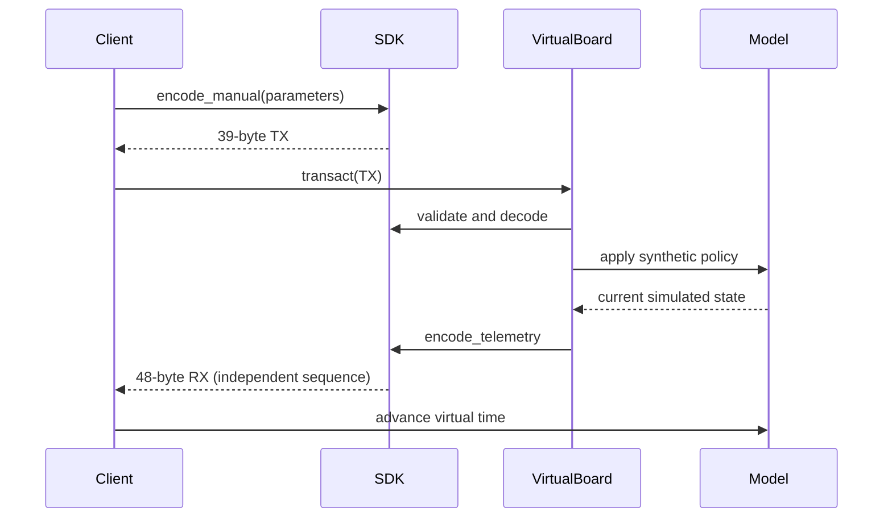

> **Historical MCS profile research.** Retained from the separate legacy toolkit. Protocol/build facts retain their stated evidence scope; API names, commands, dependency versions, screenshots and prior test counts below describe that earlier product. Use the [current unified documentation](../../../../index.md) and [current evidence and validation](../../../../evidence.md) for SDK 0.1.0.

# Historical MCS wire specification

This original factual specification covers APK `com.tecpal.device.mc30`, versionName **1.2.14.15**, versionCode **10214015**, SHA-256 `6ad1e58869eb4287a6f8b0fa0cb931941fe527e8e4b661f2f86fc005548518ef`. It describes static software evidence, not measured hardware. All wire layouts/tables below are **CONFIRMED_IN_APK** unless marked otherwise. Field names describe APK interpretation. Physical action, polarity and timing fidelity are not established. No item is HARDWARE_VERIFIED.

## Envelope

Canonical frame: `AA | L:u16be | bitmap-size=02 | 4F42 | subtype | sequence | CMD:u16be | fields | checksum`. `L = total bytes - 1`; it includes the two length bytes and checksum but excludes AA. Payload begins at offset 8 for bitmap size 2. General envelope payload offset is `6 + bitmap_size`. At least a two-byte opcode is required. The minimum supported general frame is 10 bytes for a one-byte bitmap. Multibyte integer fields use big endian where stated; opaque blocks have no inferred endianness.

Checksum is **positive** `sum(frame[1:-1]) & 255`: exclude AA and the checksum, include length, bitmap size, bitmap, subtype, sequence and payload. It is neither CRC nor additive complement. Example TX query `AA 00 0A 02 4F 42 00 01 FE 03 9F` has total 11 and L=10. The sequence counter increments modulo 256 and skips 0x66 after 0x65. Zero is allowed on wrap. Legacy and Multo serializers keep separate counters. Active timers can retransmit the same prebuilt sequence. Correlation, ACK, deduplication and loss inference remain **UNKNOWN**.

Android service selects `/dev/ttyMT1`, 9600 baud. Voltage, connector, flow control and stop-bit configuration are UNKNOWN. `cfmakeraw` is insufficient evidence of a complete 8N1 setup. The SDK implements no physical UART access.

## TX · 39 bytes

| Field | Offset | Bytes | Encoding |
|---|---:|---:|---|
| header | 0 | 1 | AA |
| length | 1 | 2 | u16be; frame size minus 1 |
| bitmap_size | 3 | 1 | u8 |
| bitmap | 4 | 2 | 4F42 |
| subtype | 6 | 1 | u8 |
| sequence | 7 | 1 | u8; not guaranteed ACK |
| opcode | 8 | 2 | u16be |
| temperature | 10 | 6 | level:u8,const:u16be,unit:u8,reserved:2 |
| motor | 16 | 3 | level:u8,direction:u8,turbo:u8 |
| function | 19 | 1 | u8 |
| scale | 20 | 2 | body:u8,mode:u8 |
| timers | 22 | 9 | current,countdown,appointment; HMS each |
| light | 31 | 2 | type:u8,brightness:u8 |
| button | 33 | 1 | u8 |
| remarks | 34 | 4 | opaque |
| checksum | 38 | 1 | sum bytes 1..37 modulo 256 |

## RX · 48 bytes

| Field | Offset | Bytes | Encoding |
|---|---:|---:|---|
| header | 0 | 1 | AA |
| length | 1 | 2 | u16be; frame size minus 1 |
| bitmap_size | 3 | 1 | u8 |
| bitmap | 4 | 2 | 4F42 |
| subtype | 6 | 1 | u8 |
| sequence | 7 | 1 | u8; not guaranteed ACK |
| opcode | 8 | 2 | u16be |
| firmware | 10 | 2 | u16be |
| state | 12 | 3 | bits + 2 reserved |
| error | 15 | 1 | u8 |
| return_code | 16 | 1 | u8; semantics UNKNOWN |
| temperature | 17 | 8 | level:s8,returned:s16be,actual:s16be,unit:s8,reserved:2 |
| motor | 25 | 3 | level:s8,direction:s8,turbo:s8 |
| function | 28 | 1 | u8 |
| scale | 29 | 7 | unit/decimals:u8,weight:s32be,state:u8,calibration:u8 |
| timers | 36 | 9 | current,countdown,appointment; unsigned HMS each |
| light | 45 | 1 | raw byte; Java signed getter |
| button | 46 | 1 | raw |
| checksum | 47 | 1 | sum bytes 1..46 modulo 256 |

## Subfields

| Direction | Absolute offsets | Interpretation |
|---|---|---|
| TX | 10; 11–12; 13; 14–15 | temperature level u8; constant u16BE; unit u8; opaque remarks |
| TX | 16; 17; 18 | motor raw level u8; direction byte; turbo lock byte |
| TX | 20; 21 | scale body; scale mode (1 used by tare helper) |
| TX | 22–24; 25–27; 28–30 | current HMS; countdown HMS; appointment HMS |
| TX | 31; 32; 33; 34–37 | light type; brightness; button; four opaque remarks |
| RX | 12; 13–14 | state byte; opaque state remarks |
| RX | 17; 18–19; 20–21; 22; 23–24 | temperature level s8; returned s16BE; actual s16BE; unit s8; opaque remarks |
| RX | 25; 26; 27 | speed s8; direction s8 getter; turbo s8 getter; raw retained |
| RX | 29 | high nibble weight unit; low nibble decimal point count |
| RX | 30–33; 34; 35 | weight s32BE; scale state; calibration step |
| RX | 36–38; 39–41; 42–44 | current HMS; countdown HMS; appointment HMS |
| RX | 45; 46 | raw light (Java signed getter); raw button |

Legacy TX is identical through absolute offset 33, omits remarks 34–37, and places checksum at 34; total 35, L=34. Operational TX payload is 30 bytes (legacy 26); RX payload is 39. **The active registry uses `multo.structs.OperationStruct`. The similarly named `mc3` response adds Remarks and is not the active RX layout.**

The compatibility encoder preserves the extracted constant-temperature helper bug: `(byte)(T << 8)` produces a zero high byte; low byte is T. This is behavior of that helper, not a claim that the wire can never carry other u16 values. Typed command decoding retains the full u16; the synthetic board accepts only 0..255 for this field.

## Operational semantics

| Opcode | Meaning / model support |
|---|---|
| 0801 | operational query / snapshot |
| 0802 | operational configuration and stop |
| 0803 | scale control; mode 1 used for tare; other calibration behavior UNKNOWN |
| 0805 | registered operation, semantics UNKNOWN; virtual board rejects |
| 0810,0811 | CookStatus registered; raw preservation |
| 0812 | SetCookStatus registered; raw preservation |
| 0813 | AllCookStatus registered; raw preservation |
| 0821–0826 | Scale structures registered; raw preservation |
| 0831 | Version structure registered; raw preservation |
| FE01–FE06 | OTA layouts; see [OTA](ota.md) |

| Function | APK name / ambiguity |
|---:|---|
| 0 | stop |
| 1 | manual_or_ramp_or_rice |
| 3 | steam_or_kettle |
| 4 | roast |
| 5 | knead |
| 6 | short_cleaning |
| 7 | long_cleaning |
| 8 | egg |
| 9 | sous_vide |
| 10 | slow_cook |
| 11 | fermentation |
| 12 | puree |
| 13 | smoothie |
| 15 | sleep |
| 198 | turbo |

Function names can share values (manual/ramp/rice and steam/kettle). A function ID does not specify the complete Android program schedule. Legacy turbo constructs a single-argument motor value interpreted as turboLock=10, speed default 0, button 6, timer 5 s; actual motor behavior is UNKNOWN. The virtual model's fallback target 20 is INFERRED and configurable in code, not a measured turbo speed.

UI speed 0..10 encodes raw level 0,2,...20. RX getters return Java signed bytes; UI division by 2 truncates toward zero. Preserve raw byte and signed interpretation. Physical RPM mapping is UNKNOWN. Direction command helpers use false=0, true=1; electrical motor orientation is not measured.

Temperature table (index → °C): `[0, 37, 40, 45, 50, 55, 60, 65, 70, 75, 80, 85, 90, 95, 100, 105, 110, 115, 120, 125, 130]`. Manual helper accepts these values only. Timer uses unsigned `[hours,minutes,seconds]`, with minute/second 0..59 and raw hours 0..255. APK manual selection is 0..5940 seconds; raw field capacity is 255:59:59. Countdown RX is converted to milliseconds by the APK; other timers remain raw in Frame. Signed temperature integers are interpreted as the APK does; real calibration and sensor accuracy are UNKNOWN.

State byte bits: 7 lid-open, 6 cup-NTC-absent, 5 temperature-HL, 3 motor-clockwise, 2 scale-stable. Bits 4,1,0 and remarks are UNKNOWN. These are application interpretations, not verified sensor electrical polarities. Weight is signed 32-bit; unit nibble/decimal count must be retained. The default twin uses unit 0, decimals 0 and grams as an explicit synthetic choice. Scale state 0 normal, 4 overload; calibration step semantics beyond the field are UNKNOWN.

| Code | APK name |
|---:|---|
| 0 | NORMAL |
| 1 | SERIAL_PORT_ERROR |
| 3 | MOTOR_FAILURE |
| 4 | VOLTAGE_OVERLOAD |
| 5 | MOTOR_ERROR |
| 6 | DRY_BURN_ALARM |
| 7 | OVER_TEMPERATURE_PROTECTION |
| 8 | TIMEOUT_PROTECTION |
| 9 | OTHER_ERROR |

Error 2 and unspecified values are UNKNOWN; preserve numeric codes. Error 1 is not proof of an actual transport failure in an imported trace. Return code semantics are UNKNOWN. LED type/brightness and button bytes are exposed without inventing complete enumerations. The twin echoes requested brightness/button as an INFERRED convenience.

## Timing, malformed input and scope

APK nominal idle query 200 ms, active TX timer 300 ms, reader sleep 100 ms, UI update 1 s. These are application scheduling values, not controller guarantees. Reader code uses fixed reads and does not reliably respect returned counts/declared length. The SDK deliberately improves strict length/checksum validation and streaming recovery. Its stream timeout is a host parser policy, not a firmware watchdog. The APK's 2000 ms application timeout can be removed on data arrival before checksum validation; it does not prove a physical safety timeout.

Exact-size parsing rejects trailing data; streaming accepts concatenated frames and partial chunks. Noise/corrupt frames are diagnosed. A plausible incomplete AA/length prefix is retained until explicit `expire(now=...)`; only then can resynchronization continue, avoiding accidental reframing of embedded AA bytes. `finish()` returns the interrupted tail. Unknown bitmap/opcode/subtype retains raw envelope data; typed operational accessors require OB/subtype 0. The virtual board raises UnsupportedCommand without fabricating a wire error for unsupported behavior. See [API](api.md) and [evidence](evidence.md).

