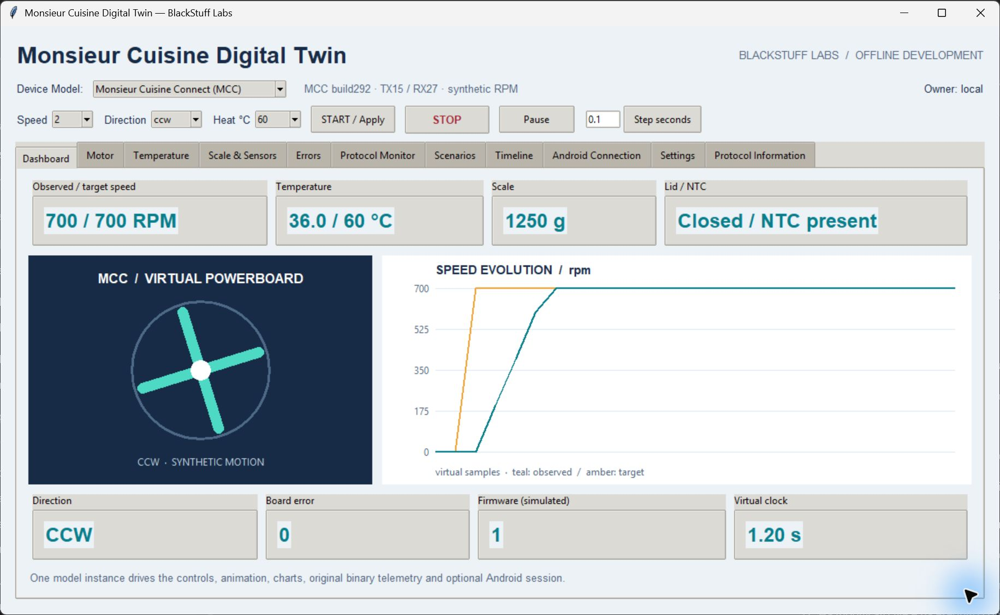

# Native Digital Twin guide

Launch the current unified desktop from an installed package:

```sh
python -m monsieur_cuisine_sdk
```

An explicit initial selection is also available with `--model mcc` or `--model mcs`. The window uses native Tk widgets and one in-process model. No browser, physical device or network listener is needed. See [setup](setup.md) if Tk is unavailable.

## First session

1. Choose **Monsieur Cuisine Connect (MCC)** or **Monsieur Cuisine Smart (MCS)** in Device Model. The protocol label, units, temperature choices, default port and capability information change together.
2. Select speed 2, direction `ccw` and Heat 60 °C. Press **START / Apply**. The observed speed rises toward its target as virtual time advances.
3. Open **Dashboard** to compare target and observed speed, temperature, scale, lid/NTC, direction, error, firmware and virtual clock. The animation is an illustrative view of model motion.
4. Press **STOP**. The requested target is removed; observed motion decays according to that profile's synthetic braking policy.
5. Use **Pause** and **Step seconds** to inspect deterministic increments. Pause freezes the virtual model clock; it is not a command sent to a physical motor. Resume continues the current virtual session.



MCC shows modeled RPM. The same UI with MCS shows raw motor levels and explicitly states that RPM is unknown. Comparing the numeric speeds across profiles does not establish physical equivalence.

## Tabs and controls

| Tab | Use |
|---|---|
| Dashboard | Common observations, synthetic blade animation and target/observed speed chart |
| Motor / Temperature | Inspect selected-profile speed and thermal behavior; use the common controls above |
| Scale & Sensors | Inject weight, actual temperature, firmware number, lid and NTC; use Tare |
| Errors | Inject the profile's board error code and configure response delay, loss, corruption or virtual disconnection |
| Protocol Monitor | Inspect original TX/RX HEX and deliberately feed selected-profile bytes with Send HEX |
| Scenarios | Run a bounded independent experiment, cancel it, verify current replay or verify a saved recording |
| Timeline | Inspect bounded host lifecycle and diagnostic events |
| Android Connection | Explicitly enable the loopback listener and inspect its client/owner/frame/error state |
| Settings | Save the current recording, create a new session, or apply profile JSON physics as a fresh session |
| Protocol Information | Read current profile capabilities, units, evidence and unsupported behavior |

Sensor batches validate before applying. A rejected value leaves the model unchanged. Injected faults are development inputs; lid/error behavior differs by native profile. The common scenario application requests STOP where required instead of assuming a universal MCU interlock. Ordinary wire STOP can be affected by a deliberately disconnected-link fault; lifecycle cleanup directly disarms targets as a simulator policy.

## Work with an Android app

Enable Android Connection only when needed. Its defaults are localhost port 8765 for MCC and 8766 for MCS. The standard emulator uses host alias `10.0.2.2` and the same selected model. Once connected, the remote application owns motor, tare and raw-command controls; host sensors/faults remain available. Desktop STOP disconnects remote ownership.

Changing model closes the old connection, cancels stale work and starts a fresh isolated generation. It does not reconnect the next model automatically. See [Android integration](android.md) for query cadence, lifecycle and actual runtime evidence.

## Save and verify

Use **Settings → Save recording** to write the current unified JSON trace. In Scenarios, **Verify current replay** compares the session's deterministic inputs, bytes and checkpoints; **Verify saved replay** verifies another unified recording on an independent instance. Verification does not replace the current interactive model.

**New session** resets the model and recording. **Apply physics as fresh session** validates the selected profile's JSON parameters before replacing the model and closes its connection. Save a trace before creating another session. The API retains the previous trace as `last_recording`, but the GUI Save control saves the current trace. Lid, NTC and error injections are profile-specific: the MCC model has no interlock (the motor and heater keep running), while the MCS model blocks motion and heating with the target retained and **resumes automatically** when the condition clears. Neither is a statement about the appliance. When the recording capacity is reached the desktop keeps simulating and reports that the rest of the session is unrecorded; save the recorded part and use **New session** to record again. [Recording policy](recording.md) explains the bounds.

Scenarios are independent bounded experiments, not physical appliance procedures. Cancellation and generation checks prevent an old result from being adopted after reset/model switch. Read each result's named checks and scope rather than treating PASS as a firmware guarantee.

The screenshots are actual captures of this unified application. [FAQ](faq.md), [troubleshooting](troubleshooting.md), [API](api.md) and [safety limits](safety.md) cover the remaining details.
